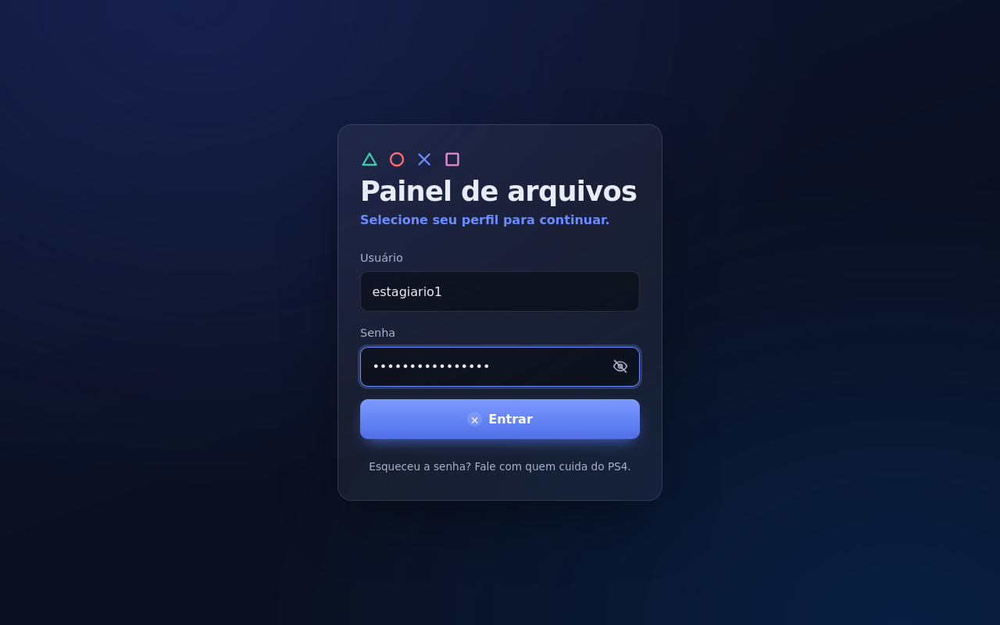
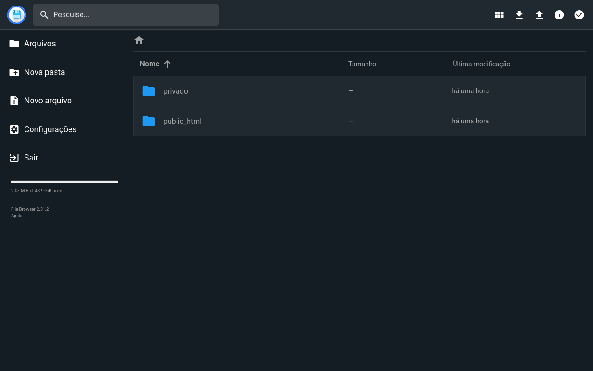
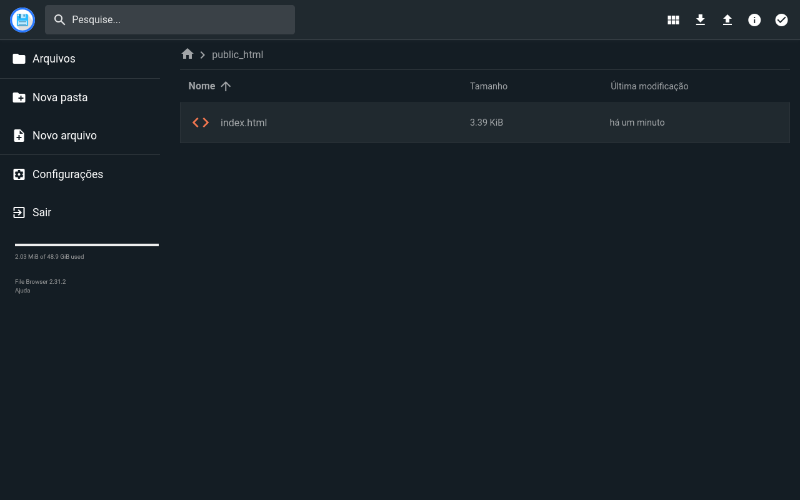
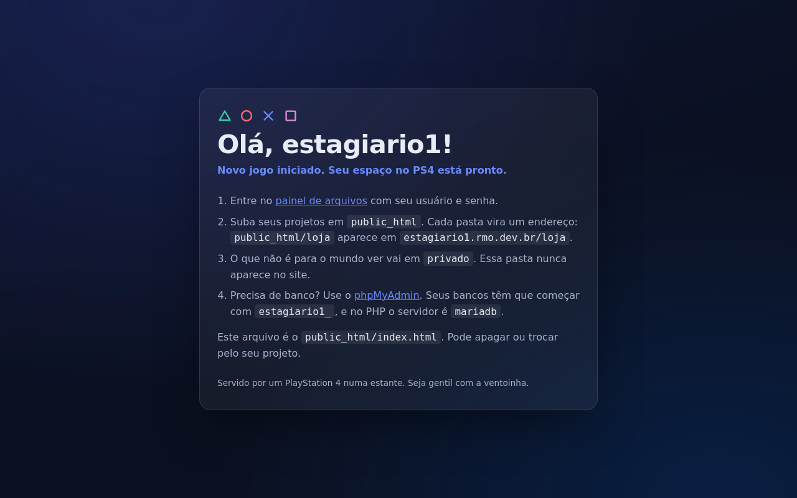
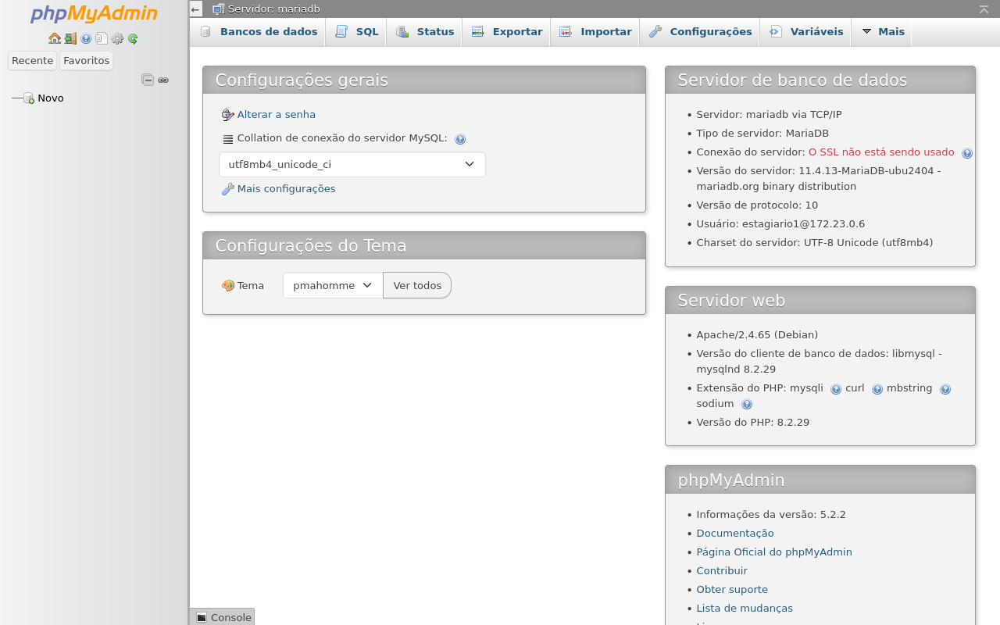
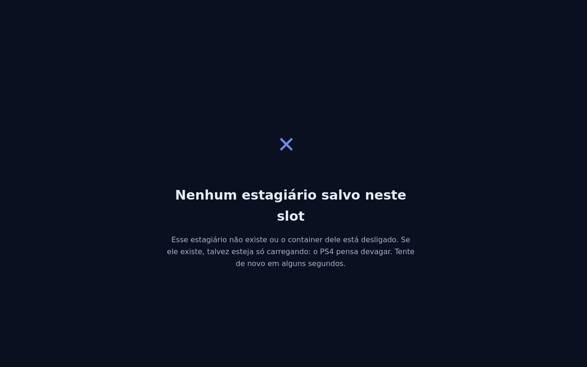
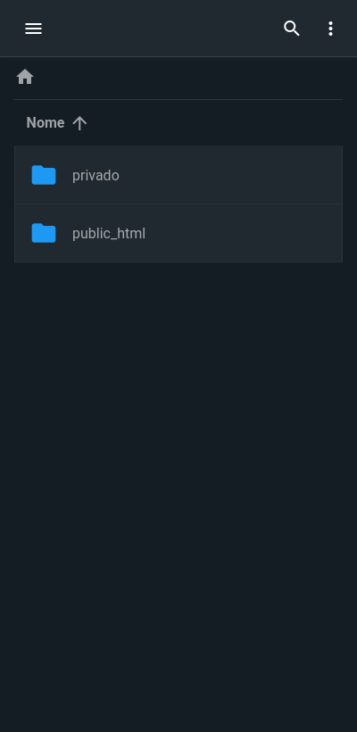

# 🎮 PlayStagiário 4

> *"Pra que AWS se eu tenho um PS4 juntando poeira?"*

Infraestrutura de hospedagem para estagiários rodando num **PlayStation 4
velho**, com Linux, ligado na rede de casa e sem IP fixo. Cada estagiário
ganha seu cantinho estilo Hostinger: site próprio, banco de dados, painel de
arquivos e um console que já rodou God of War segurando o código PHP dele.

Ele já salvou Kratos, Aloy e o Spider-Man. Agora tem a missão mais difícil
da carreira: hospedar o primeiro `index.php` do estagiário.

## O que o estagiário ganha

| Endereço | O que é |
|---|---|
| `estagiario1.rmo.dev.br/projeto1` | o site/projeto PHP ou HTML dele, para o mundo ver |
| `painel.rmo.dev.br` | gerenciador de arquivos web (cada um vê só a própria pasta) |
| `db.rmo.dev.br` | phpMyAdmin, com usuário próprio (o `DROP DATABASE` acidental só destrói o que é dele) |
| `ssh.rmo.dev.br` | SSH/SFTP, para os que já descobriram o terminal |

Na home, `public_html/` vai para o site e `privado/` nunca vai: lugar de
guardar o que não é para o mundo ver (anotações, backups, segredos do PHP).

> Usando este projeto? Troque `rmo.dev.br` pelo seu domínio.

## Tour pelo console

Prints tirados entrando como `estagiario1` (refaça com `node scripts/prints/tirar.mjs`).

**Login do painel:** usuário e senha na mesma tela, já cai na pasta do estagiário.



**Painel de arquivos:** cada um vê só a própria home. `public_html` vai para o
site, `privado` nunca vai.

| Home | Dentro do `public_html` |
|---|---|
|  |  |

**Site do estagiário:** a página de boas-vindas que todo estagiário novo
recebe, com o passo a passo. Ele apaga quando subir o primeiro projeto.



**phpMyAdmin:** em português, cada um com seu usuário e só os próprios bancos.



**Subdomínio sem dono:** o PS4 avisa que o slot de save está vazio.



**No celular:**

| Login | Painel |
|---|---|
|  |  |

## Ficha técnica do "datacenter"

| Item | Especificação |
|---|---|
| Servidor | PlayStation 4, aposentado do sofá |
| CPU | AMD Jaguar, 8 núcleos (os mesmos que faziam 30 fps no Bloodborne) |
| RAM | 7,6 GB, compartilhados com a GPU, dividindo como irmãos |
| Swap | nenhum, vivemos perigosamente |
| Disco | um arquivo `.img` dentro do HD do PS4 (é Linux dentro de um arquivo dentro de um console) |
| Rede | Wi-Fi/cabo de casa, IP dinâmico, NAT, e a fé na Cloudflare |
| Refrigeração | a ventoinha do PS4, que soa como um avião decolando |
| Uptime | até alguém tropeçar no cabo |
| SLA | "funciona na minha casa" |

## Como funciona

```
Internet ─► Cloudflare (DNS + HTTPS) ─► Cloudflare Tunnel ─► PS4 na estante
                                                              │
                         ┌────────────────────────────────────┤
                         ▼                                    ▼
                  nginx (roteia por subdomínio)          SSH / SFTP
                    │            │
       container PHP do      container PHP do       File Browser, phpMyAdmin
         estagiario1           estagiario2                  │
              │                     │                        ▼
        /home/estagiario1     /home/estagiario2           MariaDB
        (disco de 50 GB)      (disco de 50 GB)
```

O túnel da Cloudflare sai de dentro do PS4 para a internet, então não precisa
de IP fixo nem abrir porta no roteador. O roteador nem fica sabendo que virou
provedor de hospedagem.

Detalhes e o porquê de cada escolha: [docs/arquitetura.md](docs/arquitetura.md).

## Limites por estagiário

Porque a RAM é finita e o entusiasmo do estagiário, não.

| Recurso | Limite | Como é aplicado |
|---|---|---|
| Disco | 50 GB | disco virtual próprio montado como `/home/<nome>` |
| RAM | 3 GB (SSH + containers somados) | systemd `user-<UID>.slice` com `MemoryMax` |
| Banco | só bancos `<nome>_*` | usuário MariaDB com permissão por prefixo |

Passou do limite? O kernel encerra o processo do estagiário, e só o dele.
O PS4 e o colega continuam firmes.

## Requisitos

- Linux com systemd e cgroup v2 (testado no Ubuntu 26.04)
- Docker com cgroup driver `systemd` e Docker Compose
- Domínio com DNS na Cloudflare (plano Free basta)
- Um PS4 é opcional, mas recomendado pelo estilo

## Como montar do zero

Siga [docs/instalacao.md](docs/instalacao.md). O começo:

```bash
cp .env.example .env                       # preencha domínio e senha do MariaDB

# cria o estagiário (usuário, disco de 50 GB, 3 GB de RAM) e já liga tudo dele
sudo scripts/novo-estagiario.sh estagiario1

scripts/estagio ps                         # docker compose do projeto inteiro
```

As senhas geradas ficam em `credenciais/<nome>.txt`, fora do Git.

## Estrutura

```
compose.yaml        serviços compartilhados: nginx, MariaDB, phpMyAdmin, túnel
estagiarios/        modelo dos containers de cada estagiário (web + painel)
imagens/php/        imagem Apache + PHP 8.3 que roda como o estagiário
proxy/              config do nginx, tela de login do painel e páginas temáticas
modelos/            página de boas-vindas que cada estagiário recebe
config/             ajustes do phpMyAdmin (português, bancos de sistema escondidos)
scripts/            novo-estagiario.sh (sudo), ativar-estagiario.sh, estagio
scripts/prints/     tira os prints deste README entrando como estagiário
docs/               arquitetura, instalação e prints
credenciais/, .env  senhas (ignorados pelo Git)
```

## Progresso da campanha

- [x] Script de criação de estagiário (usuário, disco, RAM)
- [x] Criar `estagiario1` e `estagiario2` no servidor
- [x] Domínio `rmo.dev.br` apontado para a Cloudflare
- [x] Cloudflare Tunnel (`*.rmo.dev.br` no ar)
- [x] nginx + container PHP 8.3 por estagiário
- [x] MariaDB + phpMyAdmin com usuário por estagiário
- [x] File Browser (painel), um por estagiário
- [ ] SSH protegido pelo Cloudflare Access
- [ ] Bloqueio da rede interna para os estagiários

## Segredos

Nenhuma senha, token ou chave vive neste repositório. Elas ficam em arquivos
`.env` ignorados pelo Git; o repositório só traz `.env.example` mostrando o que
preencher. Se achar uma senha aqui, abra uma issue. E um chamado no RH.

## FAQ

**Isso é sério?**
O PS4 é sério. A infra é séria. A gente só não consegue falar dela com a cara séria.

**Aguenta quantos estagiários?**
Uns 3 a 5 com projetos leves. Depois disso o PS4 começa a fazer o barulho de
quando você abria o Red Dead 2.

**E se a energia cair?**
Aí todo mundo descobre ao mesmo tempo o que significa "alta disponibilidade".

**Dá para jogar enquanto hospeda?**
Não. Ele está rodando Linux. O console agora trabalha.
